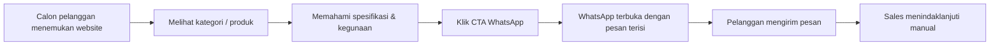

# PRODUCT REQUIREMENTS DOCUMENT (PRD) — GENERAL
## Website Katalog & Penjualan Tactile Indicator Berbasis WhatsApp

| Informasi | Detail |
|---|---|
| Nama proyek | Website Tactile Indicator — *working title* |
| Jenis produk | Website katalog e-commerce dengan konversi konsultasi/pemesanan via WhatsApp |
| Versi | 1.0 — Draft General |
| Tanggal | 2 November 2026 |
| Status | Untuk review dan persetujuan klien |
| Disusun dari perspektif | Project Manager & Business Analyst |
| Bahasa utama | Bahasa Indonesia |
| Target pasar | Indonesia, B2B dan B2C sesuai segmen yang disetujui klien |

> **Catatan keputusan desain:** Istilah “e-commerce” dalam dokumen ini berarti **catalog-commerce / inquiry-driven commerce**. Website menampilkan dan menjelaskan produk, tetapi **tidak menyediakan checkout serta pembayaran di website pada MVP**. Permintaan harga, konsultasi, dan pemesanan diarahkan ke WhatsApp. Nama brand, domain, kontak, produk aktual, harga, spesifikasi, stok, klaim sertifikasi, dan cakupan pengiriman **belum diberikan dan wajib divalidasi klien** sebelum publikasi.

---

## 1. Ringkasan Eksekutif

Website dirancang sebagai kanal resmi digital untuk memperkenalkan perusahaan dan menjual **produk Tactile Indicator** secara khusus. Website harus membuat calon pembeli mudah memahami perbedaan fungsi **guiding block (garis/pengarah)** dan **warning block (titik/peringatan)**, membandingkan varian material, menemukan spesifikasi yang dibutuhkan, serta menghubungi tim penjualan melalui **WhatsApp dengan konteks produk yang telah dipilih**.

Pendekatan bisnis berfokus pada empat hal: **kepercayaan terhadap profil perusahaan, kejelasan informasi produk, penemuan organik melalui SEO, dan konversi menjadi percakapan WhatsApp yang berkualitas**.

## 2. Latar Belakang dan Permasalahan

### 2.1 Permasalahan calon pelanggan
- Istilah *tactile indicator*, *guiding block*, dan *warning block* tidak selalu dipahami oleh pembeli awam.
- Pembeli membutuhkan kejelasan bentuk, fungsi, material, ukuran, warna, cara pemasangan, serta kecocokan untuk proyek indoor/outdoor.
- Calon pelanggan proyek sering memerlukan diskusi volume, lokasi pengiriman, dan penawaran harga sebelum memesan.
- Informasi yang tidak terstruktur dapat menimbulkan banyak pertanyaan berulang kepada sales.

### 2.2 Permasalahan bisnis yang ingin diselesaikan
- Brand membutuhkan satu situs resmi sebagai sumber informasi dan katalog produk.
- Kontak dari Google dan kanal digital perlu diarahkan ke WhatsApp dengan konteks yang tepat.
- Bisnis membutuhkan halaman produk yang dapat ditemukan mesin pencari serta dikelola tanpa harus mengubah kode untuk setiap update.
- Tim perlu mengetahui halaman/produk mana yang menghasilkan minat pembeli.

## 3. Tujuan Produk dan Indikator Keberhasilan

| Kode | Tujuan | Indikator / KPI | Cara ukur |
|---|---|---|---|
| OBJ-01 | Meningkatkan visibilitas pencarian | Impression, organic clicks, non-brand queries | Google Search Console |
| OBJ-02 | Membantu calon pelanggan memahami produk | Engagement pada halaman kategori, detail dan edukasi | GA4, event scroll/click |
| OBJ-03 | Mendatangkan calon pembeli via WhatsApp | WhatsApp CTA clicks per halaman dan per produk | GA4 event `whatsapp_click` |
| OBJ-04 | Meningkatkan kualitas inquiry | Inquiry dengan produk, varian, dan kebutuhan yang jelas | Penilaian manual/rekap sales |
| OBJ-05 | Mempermudah pengelolaan katalog | Waktu penerbitan/perubahan produk oleh admin | UAT operasional CMS |

**Target angka:** baseline dan sasaran kuantitatif (contoh conversion rate) ditetapkan sesudah audit trafik/benchmark awal bersama klien; **tidak diasumsikan** dalam PRD General.

## 4. Target Pengguna dan Kebutuhan

| Persona | Contoh | Kebutuhan utama |
|---|---|---|
| Pengadaan & kontraktor (B2B) | Kontraktor, procurement, pengelola proyek | Spesifikasi, material, ukuran, jumlah, permintaan quotation |
| Arsitek & konsultan | Perencana bangunan/aksesibilitas | Kesesuaian penggunaan, karakteristik dan dokumentasi teknis |
| Pengelola fasilitas | Mall, rumah sakit, gedung, institusi | Material yang sesuai kondisi lokasi, instalasi, dukungan konsultasi |
| Pembeli individu / UMKM | Pemilik usaha atau bangunan | Penjelasan sederhana, foto jelas, konsultasi mudah |
| Admin bisnis | Pengelola website | Mengubah produk, kategori, konten, profil, dan SEO |
| Sales | Petugas WhatsApp | Menerima pesan terstruktur dengan asal produk dan kebutuhan pelanggan |

## 5. Scope Proyek

### 5.1 In Scope — MVP (wajib)
1. Website publik responsif (desktop, tablet, mobile).
2. Beranda, profil perusahaan, katalog, kategori/penyaringan, detail produk, edukasi/FAQ, artikel, kontak.
3. Navigasi produk berdasarkan **fungsi** dan **material**, tanpa mencampur keduanya sebagai kategori yang setara.
4. CTA WhatsApp utama dan CTA WhatsApp kontekstual di detail produk.
5. Pengelolaan konten/admin (CMS) untuk produk, kategori, artikel, FAQ, dan informasi perusahaan.
6. SEO teknis dasar, on-page SEO, metadata sosial, sitemap, robots, dan schema yang sesuai data nyata.
7. Tracking analytics dan klik WhatsApp (tidak termasuk verifikasi terjadinya transaksi di luar website).
8. Validasi aksesibilitas, performa, keamanan dasar, dan UAT sebelum go-live.

### 5.2 Out of Scope — MVP
- Keranjang belanja, checkout, payment gateway, invoice otomatis, dan pembayaran online.
- Registrasi atau login pelanggan.
- Sinkronisasi stok/harga realtime ERP, CRM atau marketplace.
- Chatbot AI, live chat internal, dan sistem ticketing.
- Ongkos kirim otomatis, tracking ekspedisi, dan portal mitra.
- Integrasi WhatsApp Business API otomatis atau membaca isi percakapan WhatsApp.
- Multi-bahasa, multi-currency, atau aplikasi mobile native.

### 5.3 Fase Pengembangan Opsional
- Fase 2: formulir RFQ terstruktur, unduhan datasheet tervalidasi, portofolio proyek, landing page industri/area jika ada bukti layanan, integrasi CRM dan lead tracking.
- Fase 3: quotation portal, simulasi kebutuhan kuantitas, katalog harga B2B, integrasi stok/pembayaran bila model bisnis berubah.

## 6. Arsitektur Informasi / Sitemap

```text
/
├── /tentang-kami
├── /produk
│   ├── /produk/fungsi/guiding-block
│   ├── /produk/fungsi/warning-block
│   ├── /produk/material/beton
│   ├── /produk/material/keramik
│   ├── /produk/material/stainless-steel
│   ├── /produk/material/polyurethane
│   ├── /produk/material/karet
│   ├── /produk/material/frp
│   └── /produk/[slug-produk]
├── /panduan
│   └── /panduan/[slug-artikel]
├── /faq
├── /kontak
├── /kebijakan-privasi
└── /404
```

**Aturan sitemap:** hanya kategori/material yang benar-benar tersedia dan memiliki konten bernilai yang boleh diterbitkan atau diindeks. Hindari membuat halaman tipis atau duplikatif hanya demi keyword. Halaman filter kombinasi dinamis tidak otomatis diindeks.

## 7. Kebutuhan Fungsional — Website Publik

**Prioritas:** P0 = wajib MVP; P1 = penting jika kapasitas memungkinkan; P2 = lanjutan.

| ID | Modul | Kebutuhan fungsional | Prioritas |
|---|---|---|---|
| FR-01 | Global navigation | Logo, menu Beranda/Produk/Tentang Kami/Panduan/Kontak, pencarian atau akses katalog jelas, CTA WhatsApp | P0 |
| FR-02 | Beranda | Hero nilai jual, CTA lihat produk & konsultasi, ringkasan jenis, material, keunggulan tervalidasi, edukasi singkat, FAQ, trust signals | P0 |
| FR-03 | Tentang Kami | Profil, sejarah/identitas, lokasi, kontak, kapasitas layanan dan legalitas bila benar & disetujui | P0 |
| FR-04 | Katalog | Daftar kartu produk: foto, nama, fungsi, material, atribut utama, aksi lihat detail dan tanya WhatsApp | P0 |
| FR-05 | Katalog | Filter berdasarkan fungsi, material, dan penggunaan indoor/outdoor jika datanya tersedia; reset filter; empty state | P0 |
| FR-06 | Katalog | Pencarian berdasarkan nama/kata kunci/sinonim produk | P1 |
| FR-07 | Detail Produk | Galeri foto, nama, deskripsi singkat dan lengkap, tipe/fungsi, material, ukuran, warna, tekstur, penggunaan, opsi pemasangan, SKU bila ada | P0 |
| FR-08 | Detail Produk | Status informasi harga: tampilkan harga hanya jika sudah disetujui; default “Hubungi untuk penawaran” | P0 |
| FR-09 | Detail Produk | CTA “Tanya Produk via WhatsApp” dengan pesan otomatis berisi nama, varian, dan URL produk | P0 |
| FR-10 | Detail Produk | Produk terkait serta link ke panduan yang relevan | P1 |
| FR-11 | Edukasi | Penjelasan fungsi guiding/warning, perbedaan bahan dan contoh penggunaan; konten nonteknis mudah dipahami | P0 |
| FR-12 | Artikel | List artikel, kategori/topik, artikel detail, tanggal update bila tersedia, internal link ke produk | P0 |
| FR-13 | FAQ | Tanya jawab seperti jenis, fungsi, pilihan bahan, ukuran, pengiriman, pemesanan, pemasangan | P0 |
| FR-14 | Kontak | Nomor WA, alamat/area pelayanan aktual, email bila ada, jam operasional dan peta bila disetujui | P0 |
| FR-15 | CTA | Floating WhatsApp pada mobile/desktop, tidak menutupi konten penting | P0 |
| FR-16 | Footer | Identitas bisnis, kontak, link navigasi, kebijakan privasi | P0 |
| FR-17 | Halaman utilitas | Halaman 404 dengan navigasi kembali, loading/error states, fallback gambar | P0 |

### 7.1 Struktur konten beranda yang disarankan
1. **Hero:** headline menjelaskan apa yang dijual; subheadline menekankan fungsi/ketersediaan pilihan; CTA “Lihat Produk” dan “Konsultasi via WhatsApp”.
2. **Pengenalan:** apa itu tactile indicator dan manfaatnya untuk aksesibilitas.
3. **Pilih berdasarkan fungsi:** guiding block dan warning block.
4. **Pilih berdasarkan material:** hanya material yang dijual (misalnya beton, keramik, stainless steel, PU).
5. **Produk unggulan:** dari katalog aktual, tidak mengarang popularitas.
6. **Mengapa memilih kami:** keunggulan yang terbukti (pilihan, konsultasi, proyek, pengiriman, dsb.).
7. **Panduan singkat:** kebutuhan indoor/outdoor dan cara memilih.
8. **FAQ ringkas:** pertanyaan pembeli yang paling relevan.
9. **CTA akhir:** meminta konsultasi/penawaran WhatsApp.

### 7.2 Field wajib halaman detail produk

| Kelompok | Field | Aturan |
|---|---|---|
| Identitas | Nama produk, slug, SKU (opsional) | Nama unik; slug stabil |
| Taksonomi | Fungsi (guiding/warning), material | Relasi terstruktur, bukan sekadar tag bebas |
| Visual | Foto utama, galeri, alt text | Foto aktual, teroptimasi |
| Informasi | Deskripsi ringkas, deskripsi lengkap, manfaat, aplikasi | Bahasa awam + teknis seperlunya |
| Spesifikasi | Dimensi, ketebalan, warna, pola, metode pasang, sifat antiselip jika tersedia | Jangan mengarang nilai teknis |
| Penjualan | Harga atau “Minta Penawaran”, minimum order bila ada, status ketersediaan jika valid | Harus sesuai kebijakan bisnis |
| CTA | Nomor WA tujuan, template pesan, URL detail | Nomor terpusat dan tervalidasi |
| SEO | SEO title, meta description, canonical, OG image, index status | Bisa diedit oleh admin |
| Dokumen | Datasheet/katalog PDF opsional | Hanya file yang sudah diverifikasi |

## 8. Kebutuhan WhatsApp & Konversi

### 8.1 Alur utama


### 8.2 Format pesan otomatis (contoh)
```text
Halo, saya ingin konsultasi / meminta penawaran untuk:
Produk: [Nama Produk]
Varian: [Material / Ukuran bila dipilih]
Link: [URL Produk]
Kebutuhan: [Akan saya jelaskan]
Terima kasih.
```

- Link menggunakan format resmi `https://wa.me/<nomor-internasional>?text=<pesan-ter-encode>`.
- Nomor WhatsApp tidak di-hardcode pada banyak komponen, melainkan dikendalikan melalui konfigurasi terpusat.
- CTA homepage menggunakan pesan umum; CTA detail produk harus menyertakan konteks spesifik produk.
- Bila pelanggan belum memilih varian, jangan menambahkan varian yang tidak dipilih.
- Klik CTA dicatat sebagai **niat menghubungi**, bukan bukti pesan terkirim atau transaksi terjadi.
- Persetujuan pengguna diperlukan sebelum pengiriman pesan dari aplikasi WhatsApp mereka; website tidak mengirim pesan secara otomatis.

### 8.3 Event analytics yang dibutuhkan
- `view_item_list`: membuka katalog / kumpulan produk.
- `select_item`: memilih produk dari daftar.
- `view_item`: membuka detail produk.
- `whatsapp_click`: klik CTA WA; parameter `source_page`, `product_id` jika relevan, `cta_position`, `cta_label`.
- `search`: pencarian dalam situs, jika fitur ada.
- `filter_apply`: penggunaan filter katalog.
- `contact_view`: membuka halaman kontak.

**Catatan privasi:** hindari mengirim isi pesan, nomor telepon pribadi, atau informasi identitas pengunjung sebagai parameter analytics.

## 9. Kebutuhan Admin / CMS

| ID | Modul | Kapabilitas | Prioritas |
|---|---|---|---|
| CMS-01 | Login admin | Otentikasi aman dan hanya akun berwenang | P0 |
| CMS-02 | Produk | CRUD produk, draft/publish, upload gambar, input detail dan spesifikasi | P0 |
| CMS-03 | Kategori | Kelola fungsi, material, dan relasi kategori | P0 |
| CMS-04 | Konten website | Edit beranda, profil, kontak, CTA, FAQ | P0 |
| CMS-05 | Artikel | CRUD artikel dan kategori konten, draft/publish | P0 |
| CMS-06 | SEO | Edit title, description, slug, canonical, alt text, status index | P0 |
| CMS-07 | Media | Validasi tipe/ukuran upload, kompresi, alt text, penghapusan aman | P0 |
| CMS-08 | Pengaturan WA | Satu atau lebih nomor sesuai kebijakan, template pesan, pengaturan CTA | P0 |
| CMS-09 | Akses | Peran administrator dan editor bila lebih dari satu pengelola | P1 |
| CMS-10 | Audit | Pencatatan perubahan konten oleh admin | P1 |

**Model pengelolaan:** CMS siap pakai atau panel khusus ditentukan pada tahap technical design; yang diwajibkan adalah kapabilitas, bukan merek teknologi tertentu.

## 10. Strategi SEO

### 10.1 Tujuan SEO
Membantu Google mengindeks halaman yang benar-benar bermanfaat, menangkap pencarian terkait produk, dan menghadirkan konten yang mudah dipahami pengguna. **SEO tidak menjamin posisi #1 Google**.

### 10.2 Kelompok keyword awal (hipotesis — wajib validasi riset)
| Intent | Contoh keyword | Target halaman |
|---|---|---|
| Transaksional | jual tactile indicator, supplier tactile indicator, harga guiding block | Katalog / kategori / produk |
| Spesifik produk | tactile indicator stainless steel, guiding block beton, warning block keramik | Kategori material / detail produk yang tersedia |
| Edukasi | apa itu tactile indicator, perbedaan guiding block dan warning block | Panduan / FAQ |
| Pemilihan | tactile indicator outdoor, bahan tactile indicator untuk trotoar | Panduan relevan + produk |
| Lokal | supplier tactile indicator [kota] | Hanya jika bisnis benar-benar melayani lokasi tersebut dan punya konten unik |

### 10.3 SEO On-Page (P0)
- Satu H1 utama yang menjelaskan maksud halaman; heading H2/H3 logis.
- Judul/meta description unik, deskriptif, tidak berlebihan.
- URL singkat, stabil, mudah dibaca dan memakai slug konsisten.
- Deskripsi produk unik dan faktual, tidak *copy-paste* dari supplier tanpa nilai tambah.
- Alt text gambar bermakna; *breadcrumbs* dan internal link antar kategori, artikel, produk.
- Konten menjawab “apa produknya, untuk apa, bahannya apa, ukurannya berapa, cocok di mana, bagaimana memesan”.
- Informasi brand, kontak, dan kebijakan yang kredibel.
- Halaman nonpublik, duplikat, pencarian internal, dan parameter filter ditangani sesuai strategi index/canonical.

### 10.4 SEO Technical (P0)
- HTML konten utama dapat dirender/crawl tanpa ketergantungan penuh pada JavaScript client-side.
- XML sitemap otomatis untuk URL yang dapat diindeks; `robots.txt` sesuai kebutuhan.
- Canonical URL; 301 redirects saat slug diubah; 404 valid untuk URL tidak ada.
- Structured data yang cocok: `Organization`/`LocalBusiness` jika fakta bisnis mendukung, `BreadcrumbList`, `Product` pada detail produk dengan field yang benar-benar tersedia.
- **Jangan membuat `Offer`, harga, review, rating, stok, atau klaim “in stock” fiktif.** Untuk katalog yang tidak memiliki checkout, pertimbangkan ketentuan **product snippet** dibanding merchant listing berdasarkan kelayakan data dan alur pembelian aktual.
- Open Graph, Twitter/X preview, favicon, HTTPS, dan integrasi Google Search Console.
- Validasi structured data dengan Rich Results Test; markup valid **tidak menjamin** rich result.

### 10.5 Konten SEO prioritas
1. Apa Itu Tactile Indicator? Fungsi, Jenis dan Contoh Penggunaannya.
2. Perbedaan Guiding Block dan Warning Block.
3. Pilihan Bahan Tactile Indicator untuk Indoor dan Outdoor.
4. Cara Memilih Tactile Indicator untuk Proyek Gedung dan Trotoar.
5. Panduan Mengenali Spesifikasi dan Ukuran Tactile Indicator.

**Penting:** artikel mengenai regulasi/standar harus ditinjau dan diperbarui saat ketentuan berubah; klaim “sesuai standar” hanya ditulis jika didukung bukti produk dan pemeriksaan teknis.

## 11. UX/UI, Accessibility dan Content Design

- Mobile-first dengan navigasi sederhana, breadcrumb, tombol CTA mudah ditemukan.
- Informasi teknis dijelaskan bertahap: penjelasan singkat, manfaat, tabel spesifikasi, informasi tambahan.
- Jangan bergantung pada warna semata untuk membedakan guiding dan warning; sertakan nama dan bentuk pola.
- Gunakan foto produk nyata dan gambar yang memperjelas tekstur garis/titik.
- Kontras teks jelas, ukuran target sentuh cukup besar, focus indicator, keyboard navigation, label formulir jika ada.
- Foto memiliki alt text yang menjelaskan objek; elemen dekoratif tidak perlu alt deskriptif.
- Hindari pop-up WA yang mengganggu, terutama di perangkat mobile.
- Sediakan status saat tidak ada hasil katalog atau gambar gagal dimuat.
- Sasaran aksesibilitas pengembangan: **WCAG 2.2 Level AA** sejauh dapat diterapkan dan diuji pada MVP.

## 12. Non-Functional Requirements (NFR)

| ID | Area | Requirement / tolok ukur awal |
|---|---|---|
| NFR-01 | Responsive | Tidak ada horizontal overflow pada ukuran mobile umum; desktop/tablet/mobile diuji |
| NFR-02 | Performance | Sasaran Core Web Vitals pada p75 data lapangan: LCP ≤2,5 dtk, INP ≤200 ms, CLS ≤0,1 (sasaran, bukan jaminan sebelum data tersedia) |
| NFR-03 | Image | Responsive image, format modern sesuai dukungan, dimensi sesuai kontainer, lazy-load untuk non-hero |
| NFR-04 | Security | HTTPS, otorisasi admin, validasi input, sanitasi konten, pembatasan unggah, security headers sesuai stack |
| NFR-05 | Reliability | Halaman publik tersedia selama jam operasional yang ditargetkan; SLA hosting diputuskan klien/vendor |
| NFR-06 | Privacy | Kebijakan privasi, cookie/analytics diperlakukan sesuai kewajiban yang berlaku, minimisasi data |
| NFR-07 | Maintainability | Komponen reusable, konfigurasi bisnis terpusat, environment separation, dokumentasi deployment |
| NFR-08 | SEO | Sitemap dan canonical valid; konten inti tersedia pada HTML yang dapat dirayapi |
| NFR-09 | Quality | Lint/build/test, staging dan production terpisah, 404 dan error handling berfungsi |

## 13. User Journey & User Stories

### Journey A — Calon pembeli dari Google
1. Pengguna mencari “guiding block stainless steel”.
2. Masuk ke halaman kategori atau produk yang relevan.
3. Membaca fungsi, foto, bahan, dan spesifikasi.
4. Mengklik “Minta Penawaran via WhatsApp”.
5. WhatsApp terbuka dengan detail produk; pengguna meninjau dan mengirim pesan.
6. Sales menindaklanjuti proses penjualan di luar website.

### Journey B — Pembeli yang belum memahami produk
1. Pengguna masuk dari artikel “Apa itu tactile indicator?”.
2. Memahami dua fungsi utama (garis dan titik).
3. Membaca panduan pilihan material.
4. Beralih ke produk aktual melalui internal link.
5. Menghubungi sales lewat CTA WhatsApp.

### User stories prioritas
- **US-01:** Sebagai pengunjung awam, saya ingin melihat penjelasan guiding dan warning sehingga dapat membedakan produk.
- **US-02:** Sebagai procurement, saya ingin mengetahui dimensi, material, dan opsi produk sehingga dapat menyusun kebutuhan proyek.
- **US-03:** Sebagai pembeli, saya ingin menghubungi WhatsApp dengan nama produk otomatis agar tidak perlu mengetik ulang.
- **US-04:** Sebagai pembaca Google, saya ingin menemukan halaman yang relevan dan memahami penawarannya sebelum menghubungi sales.
- **US-05:** Sebagai admin, saya ingin memperbarui data produk dan SEO melalui CMS tanpa mengubah kode.

## 14. Acceptance Criteria Tingkat General

| ID | Skenario UAT | Kriteria diterima |
|---|---|---|
| AC-01 | Pengunjung membuka homepage | Nilai jual jelas; navigasi, katalog dan CTA WA dapat digunakan |
| AC-02 | Pengunjung menelusuri produk | Filter fungsi dan material menghasilkan produk relevan; reset dan empty-state bekerja |
| AC-03 | Pengunjung membuka detail produk | Informasi wajib tersedia sesuai data aktual; galeri, spesifikasi, link terkait tampil baik |
| AC-04 | Klik WhatsApp dari detail produk | Tujuan nomor benar dan template pesan memuat nama + URL produk yang tepat |
| AC-05 | Klik WhatsApp dari homepage | Pesan umum terbentuk dengan benar; tidak terisi produk palsu |
| AC-06 | Admin menerbitkan produk baru | Produk dapat diakses publik, punya metadata dan URL sesuai aturan publikasi |
| AC-07 | Admin mengubah slug produk | URL lama diarahkan ke URL baru bila diubah setelah publikasi |
| AC-08 | Pengujian SEO | Sitemap/robots/canonical valid, page title dan meta description unik pada halaman prioritas |
| AC-09 | Pengujian analytics | Event WA click tampil dalam pengujian GA4 dengan asal halaman benar, tanpa PII |
| AC-10 | Pengujian aksesibilitas | Navigasi keyboard, label dan contrast pada komponen utama lulus audit yang disepakati |
| AC-11 | Mobile review | Layout, gambar dan CTA berfungsi pada viewport mobile tanpa menghalangi konten |
| AC-12 | Error/404 | URL tidak valid menampilkan respons 404 dan tautan navigasi balik |

## 15. Deliverables Proyek

1. PRD General yang disetujui (dokumen ini).
2. Sitemap/Information Architecture final dan struktur konten.
3. UI/UX wireframe lalu desain high-fidelity responsif.
4. Design system dasar (typography, color, spacing, buttons, cards, states).
5. Website publik dan CMS terkonfigurasi.
6. Content entry awal: profil, produk, foto, spesifikasi, FAQ dan artikel yang diberikan/disetujui klien.
7. Implementasi SEO teknis dan analytics.
8. Test case, hasil QA/UAT, daftar isu dan persetujuan go-live.
9. Dokumentasi admin dan handover akses.

## 16. Rencana Tahapan Pelaksanaan

| Tahap | Aktivitas utama | Output / gate |
|---|---|---|
| 1. Discovery | Kickoff, validasi business model, audiens, produk, data, brand, kebutuhan SEO | Scope & konten disetujui |
| 2. UX & IA | Sitemap, user flow, wireframe, strategi CTA | Persetujuan struktur & alur |
| 3. UI | Visual design desktop/mobile, komponen dan prototipe | Persetujuan desain |
| 4. Development | Frontend, CMS, model produk, tracking, SEO | Versi staging siap uji |
| 5. Content & QA | Input konten riil, test mobile, performance, SEO, aksesibilitas, UAT | UAT sign-off |
| 6. Go-live | Domain, deploy, submit sitemap, monitoring error & traffic | Live & handover |

**Estimasi durasi dan biaya tidak dicantumkan** karena bergantung pada jumlah SKU, kesiapan aset, kompleksitas CMS, dan persetujuan desain.

## 17. Dependencies, Risiko, dan Mitigasi

| Risiko / dependensi | Dampak | Mitigasi |
|---|---|---|
| Data spesifikasi/foto produk belum lengkap | Halaman produk sulit dipercaya | Template master data produk dan persetujuan konten oleh klien |
| Harga dan ketersediaan sering berubah | Informasi menyesatkan | Default “Minta Penawaran”; publish harga hanya jika bisa dipelihara |
| Klaim sertifikasi/standar tidak terbukti | Risiko reputasi dan kepatuhan | Wajib bukti dan approval sebelum klaim dipublikasi |
| Nomor WhatsApp salah / tidak aktif | Kehilangan calon pelanggan | Test E2E CTA di beberapa perangkat sebelum go-live |
| SEO mengandalkan halaman keyword berulang | Konten tipis/duplikat | Prioritaskan konten unik, index hanya halaman bernilai |
| Hasil penjualan tidak terlihat dari GA4 | Salah membaca konversi | Pisahkan WA click dari inquiry terkirim dan deal closing |
| Tidak ada pemilik konten pasca-launch | Website cepat usang | Tetapkan penanggung jawab konten dan frekuensi review |
| Konten belum responsif/aksesibel | Pengalaman buruk dan kehilangan pengguna | QA mobile dan accessibility sebelum release |

## 18. Asumsi dan Keputusan yang Harus Dikonfirmasi Klien

| Kode | Pertanyaan keputusan | Status |
|---|---|---|
| D-01 | Apa nama brand, legal entity dan domain? | Belum dikonfirmasi |
| D-02 | B2B saja atau juga B2C? | Belum dikonfirmasi |
| D-03 | Material yang **benar-benar dijual**? Beton/keramik/stainless/PU/karet/FRP hanyalah kandidat | Belum dikonfirmasi |
| D-04 | Berapa jumlah SKU, foto, varian dan spesifikasi aktual? | Belum dikonfirmasi |
| D-05 | Harga ditampilkan, mulai dari harga, atau seluruhnya minta penawaran? | Default MVP: minta penawaran |
| D-06 | Nomor WhatsApp sales, jam respons, dan PIC? | Belum dikonfirmasi |
| D-07 | Cakupan pengiriman dan layanan pemasangan? | Belum dikonfirmasi |
| D-08 | Apakah ada sertifikasi, datasheet, test report, portofolio proyek yang dapat dibuktikan? | Belum dikonfirmasi |
| D-09 | Siapa yang memasok copywriting, foto, dan menyetujui fakta produk? | Belum dikonfirmasi |
| D-10 | Apakah CMS memerlukan beberapa role/approval editorial? | Belum dikonfirmasi |
| D-11 | Platform/stack, hosting, domain dan pihak pengelola setelah serah terima? | Belum dikonfirmasi |
| D-12 | Target bisnis dan baseline KPI untuk 3–6 bulan awal? | Belum dikonfirmasi |

## 19. Definition of Done — MVP

MVP dinyatakan siap dirilis setelah: (a) daftar produk/konten disetujui klien; (b) semua P0 selesai; (c) alur WhatsApp diuji; (d) analytics dan SEO teknis diuji; (e) responsif, keamanan dasar, performa dan aksesibilitas melewati pengujian yang disepakati; (f) tidak terdapat bug blocker/critical; (g) admin dapat mengelola konten; dan (h) klien menandatangani UAT/go-live sign-off.

---

## 20. Referensi Praktik dan Regulasi

1. Google Search Central — SEO Starter Guide: https://developers.google.com/search/docs/fundamentals/seo-starter-guide
2. Google Search Central — Creating helpful, reliable, people-first content: https://developers.google.com/search/docs/fundamentals/creating-helpful-content
3. Google Search Central — SEO best practices for ecommerce sites: https://developers.google.com/search/docs/specialty/ecommerce
4. Google Search Central — Introduction to Product structured data: https://developers.google.com/search/docs/appearance/structured-data/product
5. Permen PUPR No. 14/PRT/M/2017 — Persyaratan Kemudahan Bangunan Gedung (termasuk jalur pemandu). **Verifikasi keberlakuan dan ketentuan teknis terbaru secara terpisah untuk klaim kepatuhan produk.**
6. W3C — WCAG 2.2: https://www.w3.org/TR/WCAG22/

> Dokumen ini merupakan **PRD General untuk penyelarasan bisnis dan produk**, bukan desain database, spesifikasi API, PRD per page/per phase, dokumen hukum, atau sertifikasi kesesuaian produk.
