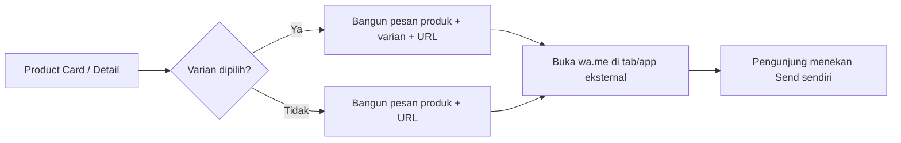

# PRODUCT REQUIREMENTS DOCUMENT — UI/UX & FRONTEND
## Tactile Indicator — Product Catalog & WhatsApp Commerce

| Metadata | Detail |
|---|---|
| Versi | 1.0 — UI/UX & Frontend Specification |
| Tanggal | 2 November 2026 |
| Acuan | PRD General Website Katalog & Penjualan Tactile Indicator v1.0 |
| Perspektif | Senior UI/UX Designer & Senior Frontend Engineer |
| Lingkup | Website publik **UI/UX dan Frontend saja** |
| Design direction | **Minimalist / Bold / Tactical / Industrial** |
| Component foundation | [Preline UI](https://preline.co/docs/) |
| Icon system | [Lucide](https://lucide.dev/icons/) |
| Styling | Tailwind CSS — monochrome (neutral/zinc) |
| Display font | Bebas Neue |
| Body/UI font | Plus Jakarta Sans (utama), Inter (fallback/alternatif; pilih satu untuk konsistensi) |
| Conversion model | Katalog dan permintaan penawaran via WhatsApp, **tanpa checkout** |
| Status | Draft untuk review desain dan engineering |

> **Batasan tegas:** Dokumen ini hanya mendefinisikan pengalaman pengguna, visual design system, komponen, route/halaman publik, perilaku antarmuka, struktur frontend, aksesibilitas, SEO yang menjadi tanggung jawab frontend, performa, dan acceptance criteria. **Tidak mencakup implementasi backend, database, CRUD, autentikasi admin, API server, CMS, integrasi CRM, WhatsApp Business API, pemrosesan pesanan, ataupun payment gateway.** Konten produk, gambar, legalitas, klaim teknis, harga, stok, kontak, dan cakupan layanan adalah data yang harus disediakan/disetujui klien.

---

## 1. Executive Design Brief

### 1.1 Konsep
Membangun website katalog Tactile Indicator yang terlihat **presisi, tegas, industrial, terpercaya, tetapi mudah dibaca pembeli awam**. Produk tetap menjadi pusat perhatian. Gaya tactical diterapkan melalui tipografi display besar, grid modular, garis pemisah tipis, label numerik, layout editorial, serta foto tekstur/material nyata — **bukan** melalui visual militer, dekorasi berlebihan, atau animasi yang menghambat.

### 1.2 Outcome pengguna
1. Pengunjung memahami perbedaan **guiding** dan **warning** dalam hitungan detik.
2. Pengunjung menemukan produk menurut **fungsi, material, dan penggunaan**.
3. Pengunjung dapat membaca spesifikasi produk tanpa harus meminta informasi dasar ke sales.
4. Pengunjung dapat mengirim inquiry WhatsApp dengan konteks produk yang relevan.
5. Pengunjung menemukan konten edukasi melalui mesin pencari dan menavigasi ke produk yang tepat.

### 1.3 Prinsip experience
- **Clarity over decoration:** istilah teknis selalu dijelaskan sederhana.
- **Scan first, read deeper:** headline ringkas; spesifikasi dapat dipindai; detail tersedia ketika dibutuhkan.
- **Product first:** foto, nama, material, fungsi, spesifikasi, CTA ditempatkan dengan prioritas jelas.
- **Mobile conversion:** jalur menuju WhatsApp tidak boleh tersembunyi di mobile.
- **Credibility by evidence:** tidak menampilkan angka proyek, sertifikat, testimoni, atau badge yang belum disetujui klien.
- **Accessible by design:** kontras, fokus keyboard, hierarki heading, target sentuh, teks alternatif dan motion reduction.

## 2. Scope & Non-Scope

### 2.1 In scope
- UX research ringan berbasis stakeholder interview, content inventory dan competitor/heuristic review (tanpa mengasumsikan hasil riset yang belum dilakukan).
- Information architecture, user flow, low/high-fidelity wireframe, responsive mockup dan interactive prototype.
- Design system, reusable components, responsive states, interaction states.
- Implementasi frontend halaman publik: Home, Tentang Kami, Katalog, kategori fungsi, kategori material, Detail Produk, Panduan/Artikel, FAQ, Kontak, Privacy, 404.
- Katalog: filter dan search **di sisi klien terhadap dataset yang tersedia**; empty state dan reset.
- Product detail: galeri, atribut, spesifikasi, related products dan CTA WhatsApp.
- SEO frontend: semantic HTML, title/description, canonical, Open Graph, structured data berdasarkan fakta aktual, breadcrumbs, internal links, crawlable content, sitemap/robots **jika dihasilkan oleh framework/deployment frontend**.
- Core Web Vitals, image optimization, lazy loading, layout stability, keyboard navigation, reduced motion, screen reader audit.
- Unit/component test, interaction test, responsive QA, accessibility QA dan end-to-end test alur publik.
- Analytics event emission dari UI bila ID/konfigurasi disediakan; tanpa membangun dashboard atau pipeline analytics.
- Data adapter/interface dan mock fixture untuk pengembangan mandiri frontend.

### 2.2 Out of scope
- Server/API endpoints, database dan migrations, penyimpanan leads, admin dashboard/CMS, login dan role permission.
- Pengelolaan media dan upload pipeline sisi server; hanya rendering aset yang disediakan.
- Integrasi stok, harga real time, penyimpanan keranjang, checkout/pembayaran, invoice, pelacakan pesanan.
- Otomatisasi pesan, WhatsApp API, chatbot, webhook atau membaca hasil chat WhatsApp.
- Crawling/ranking guarantee, jasa pembuatan artikel dalam jumlah besar, backlink/outreach SEO, paid ads.
- Implementasi CRM atau analisis transaksi offline.

### 2.3 Asumsi & dependency
- Brand name, logo, nomor WA (format internasional), business copy, data SKU, foto, kategori yang benar-benar dijual, harga/kebijakan penawaran, dan legalitas masih **TBD**.
- MVP dapat dibuat dengan **dataset statis terkurasi** atau data read-only dari sumber eksternal pada fase integrasi; keputusan final sumber data **bukan** scope backend dokumen ini.
- Halaman material yang tidak punya produk/konten valid **tidak dipublikasikan sebagai halaman kosong untuk SEO**.
- Kontrak data dan metadata disepakati dengan pemilik konten sebelum integrasi.

## 3. User Personas & Jobs-to-be-Done

| Persona | Jobs-to-be-Done | UI yang diperlukan |
|---|---|---|
| Procurement/kontraktor | Menemukan produk sesuai spesifikasi dan minta harga proyek | Filter material, tabel spesifikasi, konteks varian di WA |
| Arsitek/konsultan | Memahami fungsi, dimensi dan aplikasi | Artikel edukatif, specs, perbandingan material |
| Facility manager | Memilih untuk indoor/outdoor dan konsultasi penggantian | Use-case, rekomendasi bersyarat, link kontak |
| Pembeli awam | Membedakan guiding/warning tanpa istilah rumit | Visual pola, definisi singkat, FAQ, navigasi sederhana |

### 3.1 UX success metrics (instrumentasi frontend)
- CTA WhatsApp click-through per halaman/produk/posisi.
- Catalog-to-product-detail click-through.
- Product-detail-to-WhatsApp CTA clicks.
- Penggunaan filter dan zero-result rate.
- Organic landing-page engagement dan navigasi ke detail produk.
- **Bukan** nilai penjualan atau jumlah WhatsApp terkirim; keduanya tidak dapat dipastikan dari UI saja.

## 4. Information Architecture & Navigation

```text
/
├── /tentang-kami
├── /produk
│   ├── /produk/fungsi/guiding-block
│   ├── /produk/fungsi/warning-block
│   ├── /produk/material/[material-slug]   (hanya material aktif)
│   └── /produk/[product-slug]
├── /panduan
│   └── /panduan/[article-slug]
├── /faq
├── /kontak
├── /kebijakan-privasi
└── /404
```

**Navigation:** logo → home; nav utama: Produk, Tentang Kami, Panduan, FAQ, Kontak; CTA utama **Konsultasi WhatsApp**. Pada mobile gunakan menu hamburger dengan focus trap dan Escape untuk menutup. Header sticky ringan setelah scroll jika tidak menutupi area konten; breadcrumb untuk semua route bertingkat. Filter kombinasi via query parameter adalah **UI state**, tidak otomatis menjadi halaman indexable.

### 4.1 Primary journeys
**Journey A — pembeli awam:** Google → artikel “Guiding vs Warning” → kategori fungsi → detail produk → WhatsApp.

**Journey B — procurement:** Home/Katalog → filter material + fungsi → detail → cek dimensi/opsi → WhatsApp inquiry dengan konteks produk.

**Journey C — brand trust:** Home → Tentang Kami → katalog → kontak/WhatsApp.

### 4.2 Flow WhatsApp


## 5. Visual Identity & Art Direction

### 5.1 Art direction: Monochrome Industrial
- **Mood:** precision engineering, architectural catalog, industrial material, editorial brutalist *lite*.
- **Visual language:** bidang putih/hitam besar, border 1px, grid modular, crop produk secara close-up, tekstur dan bahan sebagai visual utama.
- **Icon:** line icons Lucide konsisten, biasanya 18–22px, stroke 1.75–2; icon mendampingi teks, tidak menggantikan label penting.
- **Shape:** rectangular, radius kecil 0–4px; jangan gunakan pill secara masif.
- **Imagery:** foto aktual produk di latar netral, detail pola garis/titik, macro texture, contoh pemasangan hanya jika tervalidasi.
- **Avoid:** camouflage, efek distressed berlebihan, noise berat, gradients cerah, glow, neon, dekorasi chevron berlebihan, teks all-caps untuk paragraf.
- **Brand exceptions:** foto produk boleh memuat warna asli kuning/merah/material; jangan memaksakan monochrome pada foto jika mengubah kenyataan produk. Ikon WhatsApp boleh memakai identitas platform jika disetujui brand, tetapi warna CTA utama tetap hitam/putih.

### 5.2 Tailwind monochrome palette
Gunakan **Neutral** sebagai palet utama (bukan mencampur seluruh Neutral/Zinc/Stone di berbagai komponen).

| Token | Tailwind | Hex acuan | Kegunaan |
|---|---|---|---|
| `--surface` | `neutral-50` | `#fafafa` | Background halaman |
| `--surface-elevated` | `white` | `#ffffff` | Card / container |
| `--surface-dark` | `neutral-950` | `#0a0a0a` | Hero/CTA gelap |
| `--text-primary` | `neutral-950` | `#0a0a0a` | Heading / body |
| `--text-secondary` | `neutral-600` | `#525252` | Supporting copy |
| `--border-default` | `neutral-200` | `#e5e5e5` | Border dividers |
| `--border-strong` | `neutral-700` | `#404040` | Divider di latar gelap |
| `--text-inverse` | `white` | `#ffffff` | Teks pada latar gelap |
| `--interactive-hover` | `neutral-800` | `#262626` | Hover primary dark |
| `--focus-ring` | `neutral-950` | `#0a0a0a` | Keyboard focus light UI |

Teks supporting wajib diuji kontras pada surface pemakaian; untuk fokus pada dark UI, gunakan ring putih + offset. Semantic error/success boleh memakai warna fungsional terbatas bila benar-benar dibutuhkan dan tetap aksesibel; jangan menjadikannya warna brand.

### 5.3 Typography
- **Bebas Neue:** display hero, section headline besar, nomor editorial, judul kampanye. **Jangan** untuk paragraf, tombol kecil yang padat, body specs, atau seluruh halaman.
- **Plus Jakarta Sans:** body, navigation, button, card title, table, labels; rekomendasi default. **Inter** hanya alternatif bila disetujui, bukan dipakai acak bersama Plus Jakarta Sans.
- Heading `h1` display desktop 64–96px (clamp), mobile 40–56px; `h2` display desktop 44–64px/mobile 32–40px; body 16–18px (line-height 1.5–1.7); metadata 12–14px dengan kontras memadai.
- Bebas Neue letter spacing 0 hingga sedikit positif; hindari pemaksaan `tracking-widest` berlebihan. Spesifikasi dan nama material menggunakan case standar agar mudah dibaca.
- Perhatikan subset/weight font, `font-display: swap`, fallback `sans-serif`, dan CLS; self-host bila lisensi memungkinkan.

### 5.4 Layout system
- Mobile first: 320/360/390px; tablet 768px; desktop 1024/1280/1440px; large 1920px.
- Content max width 1280–1360px, padding mobile 16–20px, tablet 32px, desktop 48px jika sesuai viewport.
- Grid desktop 12 kolom; tablet 8; mobile 4 konseptual. Katalog 1 kolom kecil, 2 kolom di mobile lebar bila keterbacaan memungkinkan, 3–4 desktop.
- Spacing dari skala Tailwind 4/8/12/16/24/32/48/64/96; section vertical 56–112px desktop dan 40–72px mobile.
- Border 1px + whitespace; bayangan minimal/none. Hover lewat transform kecil dan border contrast, tidak bergantung animasi besar.

### 5.5 Brand voice & UI microcopy
- Profesional, tegas, konkret, ramah pembaca awam.
- Contoh hero: **“TACTILE INDICATOR UNTUK AKSESIBILITAS YANG LEBIH TERARAH”**; subcopy menjelaskan guiding/warning, material yang tersedia, dan konsultasi.
- CTA utama: “Konsultasi via WhatsApp”; kontekstual: “Tanya Produk Ini”, “Minta Penawaran”, “Lihat Spesifikasi”.
- Tidak menyatakan “produk terbaik”, “nomor 1”, “bersertifikat”, “ready stock”, atau “pengiriman seluruh Indonesia” tanpa validasi klien.

## 6. Reusable Component Design System

**Aturan komponen:** Preline dipakai sebagai fondasi markup/pattern (adaptasi Tailwind & accessibility), bukan menyalin style default secara mentah. Preline menyediakan snippet HTML/JSX, **bukan paket komponen React siap pakai**. Dalam frontend React/Next, bungkus pattern yang telah dipilih menjadi typed reusable component; cek lifecycle JavaScript plugin Preline terutama jika komponen dirender dinamis. Jika interaksi sederhana lebih stabil dibuat dengan React native, jangan memasukkan plugin JS Preline secara berlebihan.

| Komponen | Sumber/pola | Variants dan states | Kebutuhan |
|---|---|---|---|
| `SiteHeader` | Preline Navbar | default, scrolled, mobile open | logo, nav, WA CTA |
| `MobileNav` | Preline Collapse/Overlay adapted | closed/open/focus | keyboard, focus, backdrop |
| `Breadcrumbs` | Preline Breadcrumb | normal/current | semantic `nav` + `aria-label` |
| `Button` | Preline Buttons | primary dark, light outline, text, disabled, loading | accessible focus, icon optional |
| `WhatsAppCTA` | Button + Lucide `message-circle`/brand asset approved | general/product, desktop/mobile | contextual deep link, tracking |
| `ProductCard` | Preline Cards tailored | default/hover/focus/missing-photo | image, label, title, detail CTA |
| `CategoryTile` | Card editorial | guiding/warning/material | photo/diagram + short explanation |
| `FilterGroup` | Preline Forms/Checkbox | selected/empty/reset | state reflected in URL query |
| `ProductSearch` | Preline Input | idle/results/no results | submit accessible, debounce optional |
| `FilterDrawer` | Preline Overlay adapted | closed/open/apply/reset | mobile filter, focus trap |
| `ProductGallery` | image grid + modal/dialog if needed | selected/loading/error | thumbs/buttons, image alt, keyboard |
| `SpecTable` | semantic HTML table | with/without values | no horizontal clipping |
| `Badge` | Preline Badge adapted | function/material | plain monochrome labels |
| `AccordionFAQ` | Preline Accordion | collapsed/expanded | proper buttons/ARIA |
| `ArticleCard` | Preline Card tailored | default/hover | topic, title, excerpt |
| `RelatedProducts` | responsive grid | 0/1/multiple | hide section if no data |
| `SectionHeading` | custom | light/dark, numbered | display + intro |
| `Pagination` | Preline Pagination | active/disabled | real `href`, crawlable |
| `EmptyState` | custom | zero results/no data | explanation + reset |
| `Skeleton` | Preline Skeleton | card/detail | preserve layout dimensions |
| `Toast/Alert` | Preline Alert (when needed) | info/error | no false success claim |
| `SiteFooter` | custom/Preline layout | responsive | legal, contact, links |

**Icon mapping (Lucide):** `menu`, `x`, `arrow-up-right`, `arrow-right`, `chevron-down`, `chevron-right`, `search`, `sliders-horizontal`, `ruler`, `layers`, `package`, `map-pin`, `phone`, `mail`, `message-circle`, `external-link`, `check`, `info`, `shield-check` (hanya bila klaim terbukti). Lucide `message-circle` bukan logo resmi WhatsApp; gunakan teks label “WhatsApp” atau ikon brand berizin bila membutuhkan identifikasi platform yang eksplisit.

### 6.1 Component states wajib
Default, hover (pointer), keyboard focus-visible, pressed/active bila relevan, disabled, loading/skeleton, empty, error/failed image, mobile/desktop, dan long-text/overflow. Jangan menyembunyikan informasi penting pada hover saja.

## 7. Page-Level UX/UI Requirements

### PAGE-01 — Homepage `/`
**Goal:** menjelaskan produk dan mengarahkan dua intent: eksplorasi katalog atau konsultasi.

**Urutan section (desktop & mobile):**
1. Header + top navigation + primary WA CTA.
2. **Hero** split/editorial: display H1, penjelasan 1–2 kalimat, primary “Lihat Produk”, secondary “Konsultasi WhatsApp”, visual tactile actual/macro.
3. Intro “Apa itu Tactile Indicator?” 2–3 kalimat + link Panduan.
4. **Dua fungsi utama**: Guiding (garis) & Warning (titik) dengan gambar dan label jelas.
5. **Explore by Material:** tile material **yang benar dijual**, tidak wajib menampilkan enam jenis jika belum tersedia.
6. Produk pilihan/featured (hanya jika data tersedia).
7. “Cara Memilih”: fungsi → material → lokasi penggunaan → spesifikasi.
8. Trust/proof section (hanya klaim tervalidasi).
9. Artikel edukasi terbaru/utama.
10. FAQ ringkas.
11. Large monochrome closing CTA + footer.

**Acceptance:** H1 tunggal; kedua fungsi dipahami dari label + bentuk; CTA utama di atas fold pada viewport umum; navigasi kategori bekerja; hero image tidak menyebabkan CLS.

### PAGE-02 — Tentang Kami `/tentang-kami`
**Sections:** hero company statement, profil singkat, bidang layanan, jenis produk, proses konsultasi/penawaran, bukti kepercayaan aktual, alamat/kontak dan CTA. Bila sejarah/portofolio belum tersedia, gunakan deskripsi singkat faktual — jangan membuat placeholder menjadi klaim publik.

### PAGE-03 — Katalog `/produk`
**Sections:** H1 + intro, breadcrumb, search (P1), filter fungsi/material/penggunaan (berdasar data), jumlah hasil, product grid, pagination/load-more sesuai keputusan UX, empty state, closing CTA.

**Interactions:**
- Filter chips dapat dihapus individual; reset all jelas.
- Filter mobile membuka drawer; tombol “Lihat hasil” menunjukkan count bila tersedia.
- Filter state boleh dibaca/ditulis ke URL query untuk sharing/back-forward; kombinasi filter tidak otomatis diindeks.
- Hindari memberi hasil palsu ketika tidak ada produk.
- Nama dan gambar product card membuka route detail melalui link HTML asli.

### PAGE-04 — Landing Category: Fungsi `/produk/fungsi/[slug]`
**Template:** judul “Guiding Block” atau “Warning Block”, visual pola + definisi sederhana, konteks penggunaan, product listing sesuai kategori, panduan relevan, FAQ dan CTA. Tiap halaman memerlukan konten unik; jangan hanya daftar kartu + mengganti kata kunci.

### PAGE-05 — Landing Category: Material `/produk/material/[slug]`
**Template:** karakter material, contoh aplikasi yang benar, catatan kehati-hatian/ketahanan berdasarkan data klien, produk terkait, link kategori fungsi & panduan. Route dibuat hanya untuk material terjual dan konten terverifikasi.

### PAGE-06 — Product Detail `/produk/[slug]` (prioritas konversi paling tinggi)
**Desktop:** 2-column: gallery 55–60%, product summary/CTA 40–45%; bagian bawah full-width spesifikasi + edukasi + related.

**Mobile:** gallery → nama/fungsi/material → key attributes → prominent CTA → spesifikasi → deskripsi → application → related. CTA sticky bottom **opsional** bila tidak menghalangi konten, dialog, keyboard, atau mobile safe area; selalu uji viewport 320px.

**Elemen wajib:**
- Breadcrumb; H1 nama produk faktual.
- Foto utama + thumbnail, alt text deskriptif; no fake product imagery.
- Identitas fungsi (guiding/warning), material, SKU bila ada.
- Short description dengan terminologi mudah dipahami.
- Spesifikasi terstruktur: ukuran, ketebalan, warna, motif, aplikasi, metode pemasangan **hanya data yang tersedia**; nilai kosong tidak diarang (tampilkan “Hubungi tim kami” atau sembunyikan row sesuai kebijakan).
- Harga hanya jika disetujui; default “Minta Penawaran”.
- CTA “Tanya Produk Ini via WhatsApp” dengan nama + varian terpilih + URL.
- Related products (berdasarkan kategori/material) dan tautan ke panduan.

**UX rules:** variant selector hanya bila benar ada variasi; default variant jangan diasumsikan sebagai pilihan pembeli jika belum dipilih; tombol WA berfungsi tanpa harus mengisi form; CTA membuka WhatsApp tetapi **tidak mengklaim pesan sudah terkirim**.

### PAGE-07 — Panduan `/panduan` & Article `/panduan/[slug]`
**Index:** editorial cards, topik, search/filter opsional, metadata update jika valid. **Article:** title spesifik, lead paragraph, daftar isi untuk artikel panjang, `h2/h3` hierarkis, ilustrasi/foto/diagram dengan alt, tabel mudah digulir di mobile jika perlu, tautan internal kategori/produk, CTA penutup. Konten harus menjawab pertanyaan pengguna sebelum menjual.

**Candidate articles (judul usulan, perlu validasi konten):** “Apa Itu Tactile Indicator?”, “Perbedaan Guiding Block dan Warning Block”, “Pilihan Material Tactile Indicator untuk Indoor dan Outdoor”, “Hal yang Perlu Dicek Sebelum Memesan Tactile Indicator”. Jangan memasukkan klaim standar/sertifikasi yang belum diverifikasi.

### PAGE-08 — FAQ `/faq`
Kategori FAQ: produk & fungsi, material, ukuran/varian, pemasangan, cara pemesanan, penawaran, pengiriman. Accordion keyboard accessible; pertanyaan dan jawaban harus berupa teks HTML yang dapat dibaca mesin pencari (jangan memuatnya hanya melalui klik fetch tanpa fallback).

### PAGE-09 — Kontak `/kontak`
Business identity, WA, email dan alamat/jam jika tersedia, proses konsultasi singkat, CTA utama. Peta hanya jika lokasi diverifikasi dan benar diperlukan. No form lead-storage pada MVP.

### PAGE-10 — Privacy `/kebijakan-privasi`, Not Found `/404`
Privacy copy disediakan/disetujui klien dan konsisten dengan analytics yang benar-benar dipasang. 404 memiliki headline, search/navigation, link produk dan home. Error page jangan menampilkan stack trace atau placeholder development.

## 8. WhatsApp Conversion — Frontend Specification

### 8.1 CTA placement
- Header: “Konsultasi WhatsApp” global.
- Hero: secondary/primary tergantung hierarchy.
- Product card: link “Tanya Produk” opsional tanpa menyaingi “Lihat Detail”.
- Product detail: primary CTA di area summary dan sticky mobile opsional.
- Footer/contact: global inquiry.
- Floating CTA: hanya jika tidak menutupi affordance lain; **hindari menumpuk** floating WA + sticky CTA di mobile.

### 8.2 Deep link behavior
```ts
// Contoh antarmuka client-only (bukan integrasi backend)
type WhatsAppContext = {
  kind: 'general' | 'product';
  productName?: string;
  material?: string;
  selectedVariant?: string;
  productUrl?: string;
};

function createWhatsAppUrl(phoneE164Digits: string, message: string) {
  return `https://wa.me/${phoneE164Digits}?text=${encodeURIComponent(message)}`;
}
```
- Validasi konfigurasi nomor hanya digit kode internasional tanpa `+`; kosong/invalid → CTA disembunyikan atau tampil fallback kontak yang valid, **bukan** link rusak.
- Template contoh:
```text
Halo, saya ingin meminta informasi/penawaran:
Produk: [Nama]
Material: [Material, jika ada]
Varian: [Varian terpilih, jika ada]
Link produk: [URL]
Terima kasih.
```
- Browser membuka aplikasi/site WhatsApp sesuai platform. User mengirim pesan secara manual.
- Analytics click: `whatsapp_click` dengan `source_page`, `cta_position`, `product_id` bila ada; tidak mengirim isi pesan atau data sensitif.
- External link accessibility: label menyebut “membuka WhatsApp”; periksa `target="_blank"` + `rel="noopener noreferrer"` jika membuka tab baru.

## 9. SEO — Frontend Ownership

| Area | Requirement frontend | Acceptance |
|---|---|---|
| Crawlability | Konten penting tersedia di HTML render, bukan hanya setelah JS client hydration | product H1, description, links terlihat pada HTML output |
| Semantic | `header`, `nav`, `main`, `section`, `article`, `footer`; satu H1 per halaman; H2/H3 logis | audit semantik lolos |
| Metadata | unique title/description per route; OG/Twitter; canonical absolut | preview dan source HTML sesuai |
| URLs | slug clean & stabil, meaningful 404 | no arbitrary query indexation |
| Internal links | anchor asli dengan `href` dari artikel → produk/kategori | dapat diikuti crawler |
| Structured data | `Organization`, `BreadcrumbList`, `Product`, `Article` sesuai route & **field faktual** | JSON-LD valid; jangan buat `Offer` harga/stok palsu |
| Images | alt deskriptif, rasio jelas, ukuran responsif, format modern | no generic “image1”; LCP optimized |
| Performance | CWV target LCP ≤2.5s, INP ≤200ms, CLS ≤0.1 pada p75 pengguna nyata bila data tersedia | Lighthouse lab sebagai proxy, CrUX/field bila ada |
| Sitemap/robots | generate hanya page canonical publik, hindari filter query | sitemap routes valid; no accidental noindex |
| FAQ | visible useful answers; FAQ markup hanya bila memenuhi kebijakan rich-result yang berlaku | no rich-snippet guarantee |
| Accessibility | WCAG 2.2 AA target | contrast, keyboard, headings, alt |

**Catatan SEO:** hasil ranking/traffic dipengaruhi konten, kompetisi, otoritas domain, dan faktor eksternal; frontend yang baik tidak menjamin posisi 1 Google.

### 9.1 Template metadata contoh (placeholder, wajib ganti data aktual)
- Home title: `Tactile Indicator — Guiding & Warning Block | [Brand]`.
- Product title: `[Nama Produk] — [Material] | [Brand]`.
- Category title: `Tactile Indicator [Material] — Produk & Spesifikasi | [Brand]`.
- Description: satu ringkasan unik yang benar-benar sesuai isi halaman, tanpa keyword stuffing.
- OG image menggunakan asset yang relevan dan legal, bukan gambar placeholder berulang.

## 10. Accessibility Requirements
- Target **WCAG 2.2 AA**; implementasi aksesibel bukan otomatis terjamin hanya dengan memilih Preline.
- Functional contrast minimum 4.5:1 untuk normal text dan 3:1 untuk large text serta non-text UI sesuai aturan relevan.
- Semua fungsi lewat keyboard, focus-visible jelas, urutan fokus logis, skip-to-content tersedia.
- Dialog/drawer menahan fokus saat terbuka dan mengembalikan fokus setelah ditutup.
- Tap targets minimum rekomendasi 44×44px untuk CTA penting; spacing cukup antar kontrol.
- Alt text berisi fungsi pola/foto produk, bukan mengulang keyword berlebihan.
- Label yang menjelaskan Guiding/Warning **tidak hanya mengandalkan warna**; pakai kata dan motif visual.
- Respect `prefers-reduced-motion`, tanpa auto-rotating carousel yang sulit dikendalikan.
- Table specs memiliki header semantik; overflow mobile dapat digulir tanpa memotong data.
- Validasi di VoiceOver/NVDA serta keyboard manual, tidak hanya automated audit.

## 11. Frontend Engineering Architecture

### 11.1 Stack rekomendasi (frontend saja)
- **Next.js (App Router) + TypeScript** untuk rendering SEO-friendly, route berbasis file, metadata, image optimization. Ini adalah **rekomendasi**, bukan keputusan arsitektur backend.
- **Tailwind CSS** sebagai styling, neutral tokens dan custom typography.
- **Preline UI** untuk pattern/component foundation dan interaksi yang dibutuhkan.
- **Lucide React** untuk icon SVG tree-shakeable.
- **Google Fonts atau self-hosted** Bebas Neue + Plus Jakarta Sans (lisensi dan strategi loading dicek).
- **Vitest + React Testing Library** untuk unit/component tests; **Playwright** untuk alur publik, responsive, dan keyboard smoke tests.
- Hindari library animation/slider besar jika CSS dan native APIs sudah cukup.

### 11.2 Struktur folder (illustrative)
```text
src/
├── app/
│   ├── (site)/
│   │   ├── page.tsx
│   │   ├── tentang-kami/page.tsx
│   │   ├── produk/page.tsx
│   │   ├── produk/fungsi/[slug]/page.tsx
│   │   ├── produk/material/[slug]/page.tsx
│   │   ├── produk/[slug]/page.tsx
│   │   ├── panduan/page.tsx
│   │   ├── panduan/[slug]/page.tsx
│   │   ├── faq/page.tsx
│   │   ├── kontak/page.tsx
│   │   └── kebijakan-privasi/page.tsx
│   ├── layout.tsx
│   ├── not-found.tsx
│   ├── sitemap.ts
│   └── robots.ts
├── components/
│   ├── ui/                 # Preline-inspired reusable primitives
│   ├── layout/             # Header, Footer, Breadcrumbs
│   ├── product/            # Cards, Gallery, Specs, Filters
│   └── sections/           # Home/editorial sections
├── features/
│   ├── catalog/            # hooks, selectors, client filter state
│   └── whatsapp/           # message builder, link helpers
├── content/                # validated static data or mocks during development
├── config/                 # site navigation, contacts, env-read config
├── types/                  # frontend data contracts
├── lib/                    # metadata, formatting, analytics client hooks
├── styles/                 # tokens and global css
└── tests/
```
**No** `app/api`, `server/actions`, database clients, auth server, or custom CMS implementations in scope. Server-rendered HTML framework features for SEO are allowed but **business backend development is excluded**.

### 11.3 Typed frontend content contract (illustrative)
```ts
type FunctionType = 'guiding' | 'warning';
type Product = {
  id: string;
  slug: string;
  name: string;
  functionType: FunctionType;
  materialSlug: string;
  shortDescription: string;
  description?: string;
  images: Array<{ src: string; alt: string; width: number; height: number }>;
  specifications: Array<{ label: string; value: string }>;
  applications?: string[];
  variants?: Array<{ id: string; label: string }>;
  featured?: boolean;
  seo: { title: string; description: string; canonicalPath: string };
};
```
- `Product`, `Article`, `FAQ`, `SiteSettings` sebagai **read-only UI contracts**; dipasok fixtures atau adapter.
- Jangan hardcode daftar produk atau nomor WA di komponen visual. Data dapat disediakan dalam file terpusat selama MVP.
- Image URL/alt/size diverifikasi; error image punya fallback non-deceptive.
- Query params difilter/normalisasi, jangan disisipkan sebagai HTML mentah.
- Komponen murni menerima props; data loading dipisah dari presentation.

### 11.4 Rendering strategy
- Public pages & metadata harus crawlable dari HTML awal (SSG/SSR framework sesuai sumber data yang disepakati).
- Filter UI, menu, drawer, gallery, dan interaction-only widgets sebagai client components; jangan membuat seluruh route client-only.
- Page links sebagai anchor navigation; hindari UI-only navigation dengan `onClick` yang merusak SEO.
- Dynamic imports hanya pada komponen interaktif berat; jangan menunda rendering H1/konten produk di initial page.
- Type-safe config untuk WA, links, feature flags; no secret embedded in public bundle.

### 11.5 Performance & security boundary (frontend)
- Budget awal: optimalkan JS bundle; audit ukuran aktual tiap route; hero image format next-gen, responsive `sizes`, preloading hanya LCP; defer noncritical widgets.
- Hindari hydration mismatch, image layout shifts, icon/font flashes; skeleton menjaga rasio.
- External links `rel="noopener noreferrer"`; render content sebagai text/React nodes, **hindari `dangerouslySetInnerHTML`** kecuali konten sudah disanitasi oleh sumber tepercaya di luar scope UI.
- Link WA tetap berfungsi tanpa analytics; analytics gagal tidak memblokir CTA.
- Lint, TypeScript strict, format, test, production build, Lighthouse smoke test sebagai gate.
- HTTP security headers, server-side rate limiting dan database security adalah **tanggung jawab deployment/backend**, hanya dicatat sebagai dependency handoff (bukan task frontend ini).

## 12. Interaction & Responsive Details

| Area | Desktop | Mobile |
|---|---|---|
| Header | nav horizontal + CTA | compact logo, hamburger, WA access |
| Hero | split asymmetric / product macro | stacked headline + image, CTA visible |
| Product listing | 3–4 columns | 1–2 depending min card width |
| Filtering | sidebar/chips | filter drawer + chips summary |
| Product detail | two columns | gallery-first stack, CTA prominent |
| Specifications | readable label/value table | wrapped rows or scrollable table |
| Footer | grouped columns | stacked accordion optional |
| WhatsApp | header/detail/global CTA | clear CTA, no overlapping sticky/floating |

**Breakpoints:** adapt content, don't design only for one device preset. Test 320, 375, 390, 768, 1024, 1280, 1440 and at zoom 200%.

## 13. Analytics & Event Hooks (Client Only)

| Event | Trigger | Safe params |
|---|---|---|
| `view_item_list` | katalog/kategori tampil | `list_id`, `page_type` |
| `select_item` | product card clicked | `product_id`, `list_id` |
| `view_item` | detail displayed | `product_id` |
| `filter_apply` | filter value applied | `filter_type`, `filter_value` |
| `search` | search submitted | use non-PII safe terms only; omit if unsure |
| `whatsapp_click` | WA CTA tapped | `source_page`, `product_id`, `cta_position` |

Frontend mengirim event melalui adapter analytics opsional; **tidak** mengimplementasi penyimpanan/event ingestion. Tidak mengirim nomor WA pelanggan, teks pesan WA, email, atau personal identifiers. Event click ≠ confirmed inquiry.

## 14. UX Deliverables & Handoff
1. Sitemap/IA dan primary user journeys.
2. Moodboard/style exploration (monochrome industrial).
3. Design tokens: color, type, spacing, radius, border, icons.
4. Low-fi wireframes semua template halaman.
5. High-fi responsive: desktop dan mobile untuk template utama, tablet adaptation rules.
6. Component library Figma dengan variants dan interaction states.
7. Interactive prototype untuk katalog → produk → CTA dan menu/filter mobile.
8. Copy UI/SEO outline dan image specification sheet.
9. Annotated handoff: states, breakpoints, design decisions, accessibility notes.
10. Frontend route implementation, test results, build README & deployment/config handoff.

## 15. Execution Phases & Frontend Acceptance Criteria

| Phase | Fokus | Deliverable | Exit Criteria |
|---|---|---|---|
| 01 Discovery/IA | review brief, data & SEO intent | sitemap, user flow, content inventory | IA & conversion path approved |
| 02 Visual System | art direction + typography + tokens | design foundations & core components | typography contrast + component pattern approved |
| 03 UX Screens | all responsive templates | wireframes + high-fi + prototype | core journeys usable on mobile/desktop |
| 04 Frontend Foundation | setup, tokens, reusable layout | TS strict, components, header/footer | lint/build pass; responsive shell |
| 05 Catalog & Product | category, filter, detail, gallery, WA | page routes and mock-driven UI | no broken variants, links, images |
| 06 Content & SEO | about, article, FAQ, contact, metadata | public HTML/SEO metadata | semantic/metadata validation |
| 07 QA & Handoff | audit responsiveness/accessibility/performance | QA report, fixes, README | all P0 acceptance met |

### 15.1 Definition of Done — P0
- [ ] Semua route MVP yang disepakati dapat dibuka langsung/deep-link dan memiliki 404 yang benar.
- [ ] Konten produk aktual/approved tampil, tidak ada dummy text/fake claims yang lolos ke produksi.
- [ ] Perbedaan Guiding (garis) dan Warning (titik) jelas tanpa hanya mengandalkan warna.
- [ ] Filter katalog bekerja dan hasil kosong punya reset yang berfungsi.
- [ ] Product page punya foto, deskripsi, spesifikasi yang tersedia, serta WA CTA dengan context yang tepat.
- [ ] WA URL diuji di mobile dan desktop, URL di-encode; tidak ada klaim “pesan terkirim” setelah click.
- [ ] Tidak ada overlap layout/tombol pada 320px, 375px, 768px, 1024px, 1440px.
- [ ] Text hierarchy, focus-visible, alt image, tab navigation dan dialog behavior diaudit manual.
- [ ] Metadata route unik, structured data tidak mencantumkan fakta palsu, internal links crawlable.
- [ ] LCP/CLS/INP dipantau; Lighthouse + real-device QA dilakukan, deviasi terdokumentasi.
- [ ] Strict TypeScript, lint, automated tests kritis, dan production build pass.
- [ ] Tidak ada backend/CMS/checkout/payment implementation tersisip dalam scope frontend.

### 15.2 Example acceptance scenarios (Given/When/Then)
**AC-FE-01:** Given pengunjung membuka katalog, when memilih filter `Guiding` dan `Stainless Steel`, then grid hanya menampilkan produk yang memenuhi kedua filter atau empty state dengan tombol reset.

**AC-FE-02:** Given produk memiliki varian ukuran dan pengguna memilih satu ukuran, when klik “Tanya Produk”, then WhatsApp link memuat nama, varian terpilih dan URL produk yang ter-encode dengan benar.

**AC-FE-03:** Given belum ada varian dipilih, when klik CTA, then pesan tidak menyebut varian yang tidak dipilih.

**AC-FE-04:** Given pengguna memakai keyboard, when membuka mobile navigation/filter drawer, then focus masuk ke area yang aktif, Escape menutup, dan fokus kembali ke trigger.

**AC-FE-05:** Given crawler membuka halaman product detail, then title, description, canonical, H1, product description dan anchor internal tersedia di HTML response.

**AC-FE-06:** Given product image gagal dimuat, then user melihat fallback yang proporsional dan informasi produk tetap dapat dibaca.

## 16. Prioritas Implementasi
- **P0:** Global layout/navigation, Home, About, Catalog/filter, Function & Material landing, Product Detail, WhatsApp CTA, FAQ, Contact, Article index/detail, SEO baseline, responsive, accessibility, 404.
- **P1:** onsite search, richer photo gallery zoom, related products, sticky mobile CTA (setelah QA), pagination enhancement, article TOC, advanced filter chips.
- **P2:** comparison UI, product datasheet download UI, dark-mode toggle, animated product visualization, multi-language; semua memerlukan persetujuan scope baru.

## 17. Risks & Mitigations
| Risiko | Dampak | Mitigasi UI/FE |
|---|---|---|
| Foto tidak tersedia atau kualitas rendah | kesan premium turun | standard image specs, neutral fallback, jangan generate foto sebagai representasi produk aktual tanpa label |
| Data produk tidak lengkap | detail tidak kredibel | content checklist; optional row handling; CTA konsultasi |
| Bebas Neue terlalu dominan | keterbacaan turun | display-only, body Jakarta Sans, accessibility QA |
| Preline JS plugin konflik lifecycle React | broken dropdown/drawer | gunakan pattern sederhana, test, dokumentasi framework, minimalkan plugin JS |
| Terlalu banyak ornamen tactical | distraksi, page berat | restraint: typography + border + spacing + photo |
| SEO thin/duplicate category | index quality buruk | publish hanya page kategori bermakna dan aktif |
| Floating CTA menutupi UI mobile | akses tidak nyaman | satu sticky/floating strategy per viewport; safe area |
| Klaim kepatuhan produk tidak akurat | misleading dan risiko legal | semua technical claims perlu approval klien |
| Analytics ad blocker/WA external | event data tidak lengkap | analytics sebagai indikasi klik, bukan transaksi |

## 18. Open Questions / Client Decisions (before UI finalization)
1. Nama brand, logo vector, tagline dan domain final?
2. Material dan kategori **yang benar-benar dijual**? Fungsi apa saja per material?
3. Data produk: SKU, gambar asli, dimensi, ketebalan, opsi warna, metode pemasangan, datasheet?
4. Harga akan ditampilkan atau semua “Minta Penawaran”? MOQ dan wilayah layanan jika boleh disebut?
5. Satu nomor WhatsApp pusat atau berbeda berdasarkan jenis produk?
6. Foto aplikasi proyek dan testimoni/sertifikasi/klien yang boleh ditampilkan?
7. Apakah sumber konten awal statis, lalu integrasi CMS di fase lain? Siapa penanggung jawab input dan approval konten?
8. Pilih body font final: **Plus Jakarta Sans** (direkomendasikan) atau Inter?
9. Siapa pemilik domain, GA4/GSC, privacy copy, dan persetujuan tracking?
10. Kriteria branding: editorial industrial **light dominant** dengan section dark, atau dark dominant? Rekomendasi default: **light dominant** demi kejernihan katalog dan keterbacaan.

## 19. Exemplar UI Copy (draft, not final business claims)
**Hero H1:** “TACTILE INDICATOR UNTUK RUANG YANG LEBIH AKSESIBEL”

**Hero description:** “Kenali pilihan guiding block dan warning block, jelajahi material dan spesifikasinya, lalu konsultasikan kebutuhan proyek Anda melalui WhatsApp.”

**Guiding tile:** “GUIDING BLOCK — POLA GARIS. Membantu menunjukkan arah jalur berjalan.”

**Warning tile:** “WARNING BLOCK — POLA TITIK. Memberi penanda peringatan pada area tertentu.”

**Product CTA:** “Tanya Produk via WhatsApp”

**Empty state:** “Belum ada produk yang cocok dengan filter ini. Coba ubah pilihan material atau fungsi.”

**Quote label:** “Harga dan kebutuhan volume dapat dikonsultasikan.” (hanya bila sesuai kebijakan bisnis)

## 20. Design & Engineering References
- [Preline UI — Documentation](https://preline.co/docs/)
- [Preline UI — Component Catalog](https://preline.co/docs/components.html)
- [Preline UI — Accessibility](https://preline.co/docs/accessibility.html)
- [Lucide — Icon Catalog](https://lucide.dev/icons/)
- [Tailwind CSS — Color Palette](https://tailwindcss.com/docs/colors)
- [Google Search Central — SEO Fundamentals](https://developers.google.com/search/docs/fundamentals/seo-starter-guide)
- [web.dev — Core Web Vitals](https://web.dev/articles/vitals)
- [W3C — WCAG 2.2](https://www.w3.org/TR/WCAG22/)

---

**Dokumen ini siap menjadi blueprint UI/UX design dan pengembangan frontend.** Semua hal yang menyentuh CRUD admin, penyimpanan data, database, API bisnis, CRM, WhatsApp API, atau pembayaran harus ditempatkan dalam PRD/backend scope terpisah jika dibutuhkan di kemudian hari.
